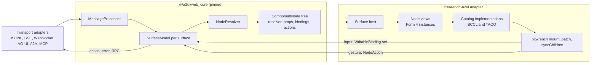

# bitwrench-a2ui: design spec

Date: November 22, 2026 (revision 2)  
Status: implemented through phase 4 (web_core build, site, docs, examples, conformance); the standalone core (section 5.1) is still planned. See `README.md` and `dev/upstream-listing.md` for the current state.  
Inputs: `tmp/bitwrench-a2ui-implementation-brief.md` (the owner brief), owner notes of November 22 (the web_core option, license, size, v1.0 only), and the research notes in `tmp/research/` (`a2ui-spec-brief.md`, `bitwrench-brief.md`, `ecosystem-brief.md`)  
Pinned sources: A2UI `a2ui-project/a2ui` at `5ff1b05f` (2026-11-20), `@a2ui/web_core` 0.15.0 on npm (0.16.0 in the repo, unpublished), bitwrench `2.1.15` (npm gitHead `41235484`)

Changes from revision 1:

* **Core** - two builds from one adapter: on Google's `@a2ui/web_core` at launch, and on our own standalone core after launch (section 5.1).
* **License** - Apache-2.0.
* **Protocol** - v1.0 only. Earlier versions are out of scope.
* **Size** - no longer a selling point. bitwrench with BCCL is in the same range as the other web renderers, which is good enough.
* **Positioning** - centered on what bitwrench brings (UI and CSS as data), with other renderers mentioned only for context.

## 1. Summary

This document proposes a design for an A2UI v1.0 renderer built on the published bitwrench 2.1.15, with no changes to bitwrench. The owner brief sets the constraints and launch plan. This spec adds the research findings, the technical design, the site and docs plan, and a list of things that still need a decision.

The short version:

* **The approach** - build a bitwrench framework adapter on top of `@a2ui/web_core`, the shared core that the official React, Lit and Angular renderers use. Core owns the protocol: messages, surfaces, data model, expressions, functions, RPC, validation and tree resolution. The adapter maps the resolved component tree into BCCL and TACO objects and renders it with bitwrench. A2UI's own adapter blueprint describes this exact shape for vanilla DOM ("Form 4: stateful instances with mount, update, unmount").
* **Why this first** - faster compatibility, Google's tested protocol semantics, and a much easier conversation with the upstream maintainers. An independent lightweight core can follow later if the dependency footprint ever matters.
* **Why bitwrench** - bitwrench treats UI structure as JavaScript data, and its CSS is data too. A2UI is itself UI as data, so bitwrench is a natural host, and its composable, generated CSS is something template-based renderers don't do as easily.
* **The wedges** - one script tag with no consumer build, the same catalog code producing live DOM or an HTML string, theming from a few seed colors with CSS composed as objects, a single-file MCP Apps build, and an inspector that shows the wire messages, the data model and the TACO side by side.

## 2. What A2UI v1.0 is, in renderer terms

This section records the protocol facts the design depends on. The full detail, with exact JSON, is in `tmp/research/a2ui-spec-brief.md`.

A2UI is declarative UI over a message stream. The agent sends a flat list of components keyed by id, plus a separate JSON data model. Components bind to the model with JSON Pointer paths. The renderer owns all rendering and runs only code from catalogs the host registered. v1.0 is marked current in `specification/versions.json`, and it is the only version this project targets. License is Apache-2.0.

The parts that shape the design:

* **Agent to renderer messages** - `createSurface`, `updateComponents`, `updateDataModel`, `deleteSurface`, plus `callRendererFunction` and `agentFunctionResponse`. Every message is `{"version":"1.0", <one key>}` with `additionalProperties:false`.
* **Renderer to agent messages** - `action`, `error`, `callAgentFunction`, `rendererFunctionResponse`.
* **The `@` sigil** - bindings are `{"@path":"/x"}`, calls are `{"@call":"fn","args":{}}`, and component mixins are `@catalogId`, `@accessibility`, `@metadata`, `@checks`.
* **Implicit root** - `createSurface` creates an unmodifiable `Surface` container whose child is the component with `id:"root"`. Components arrive in any order. Missing children render as nothing (no layout footprint) and upgrade in place.
* **Data model** - `updateDataModel` upserts at a JSON Pointer, omitted path replaces the root, explicit `null` deletes. Inputs write to the model immediately. Nothing goes to the network until an action fires.
* **Theme is gone** - v1.0 removed `theme` from `createSurface`. Styling is the host's job, which is a good fit for bitwrench.
* **Basic catalog** - 18 components (Text, Image, Icon, Video, AudioPlayer, Row, Column, List, Card, Tabs, Modal, Divider, Button, TextField, CheckBox, ChoicePicker, Slider, DateTimeInput) and 15 functions (`required`, `regex`, `length`, `numeric`, `email`, `formatString`, `formatNumber`, `formatCurrency`, `formatDate`, `pluralize`, `openUrl`, `and`, `or`, `not`, system `@index`).
* **Function routing** - functions declare `allowedCallers` and `requiresUserActivation`. Unknown functions fall back to `callAgentFunction`. `openUrl` runs only inside a real user gesture.
* **Transports** - A2UI requires ordering, framing and metadata, nothing more. AG-UI is called the standard binding. A2A has a normative extension. MCP has three documented patterns. Capabilities and the optional data model ride in transport metadata.
* **SDK layers** - A2UI defines a Core SDK (protocol and state), an Agent SDK and a Renderer SDK. The SDK docs say custom UI adapters can depend on the Core SDK directly, and point to `blueprints/modules` and `conformance/` for building one.
* **Conformance** - each SDK writes an in-process harness over the YAML suites in `conformance/`. The adapter suites are `conformance/core/adapter_conformance.yaml` and `core/accessibility.yaml`. There are also schema cases in `specification/v1_0/test/cases/` and 43 golden examples in `catalogs/basic/v1/examples/`.

## 3. Positioning

This section says what the project claims and what it does not. It follows the owner brief: be ambitious about adoption and precise about engineering.

The working one-liner is "An A2UI renderer for plain JavaScript, built on bitwrench. UI as data from the agent to the DOM, no framework or build step." The longer throughline from the brief still holds. Use A2UI when an agent needs a portable UI contract, and use bitwrench as a lightweight browser engine to draw it.

### 3.1 What bitwrench brings

The official web renderers are template-based (Lit, React, Angular), which is a reasonable design. bitwrench takes a different one, and that difference is the story:

* **UI as data** - bitwrench treats UI structure as ordinary JavaScript data throughout. A2UI is also UI as data, so the mapping from protocol to rendering is direct and inspectable.
* **CSS as data** - styles are JavaScript objects, generated from a palette, composed, merged, overridden and scoped per surface at runtime with `bw.css` and `bw.makeStyles`. That makes it easy for a host to restyle a whole agent-generated surface, or generate a theme from a brand color at runtime.
* **Where the data model pays off** - server-driven UI, embedded devices serving pages, runtime-generated controls, agent-generated interfaces, UI inspection and transformation, and UI descriptions that are downloaded or built on the fly.
* **One tree, two outputs** - the same TACO tree mounts as live DOM or renders as an HTML string through `bw.html()`, in the browser or in Node.

### 3.2 Differentiators to demonstrate

These are the points the demos and docs should show, not just state:

* **No build, no framework** - two pinned script tags and a div. Nothing else in the ecosystem offers this today.
* **Google's core, bitwrench's rendering** - protocol semantics come from `@a2ui/web_core`, so behavior matches the official renderers. The rendering, styling and inspection come from bitwrench.
* **Composable theming** - a theme from a few seed colors, light and dark, scoped per surface, with styles a host can merge and override as objects. v1.0 left theming to the host, and several official renderers have open theming issues (#602, #3257).
* **HTML output** - static export, email-safe snapshots, SSR and golden tests without a browser. Nobody in the A2UI ecosystem has this. Vercel's json-render markets email and PDF output, so it is the closest comparison.
* **Single-file MCP Apps build** - the official guide inlines a renderer with `vite-plugin-singlefile` because the iframe allows no external scripts. We can ship a ready template.
* **Inspectable** - the playground shows wire messages, data model and derived TACO side by side, which explains both A2UI and bitwrench at once.

What we do not claim:

* **Size** - not a selling point. Sizes are measured and published in `builds.json` and on the Benchmarks page without commentary.
* **Google certification** - there is none. We say "tested against the upstream conformance suites at commit X" and link the run.
* **Precedence** - bitwrench's object model predates A2UI, which is a fact worth stating once if asked. It is not a pitch.

## 4. Constraints

These come from the owner brief, adjusted for the web_core decision.

* **bitwrench unchanged** - use the published, pinned 2.1.15 and only documented APIs (those declared in `bitwrench.d.ts` or the generated API docs). No fork, no patch, no new release needed for launch.
* **No framework in the rendering path** - no React, JSX, Angular or virtual DOM. web_core itself depends on Lit for its universal elements layer. We do not use that layer, and the build must show that Lit is not in our bundle (section 5.1).
* **No consumer build** - plain ESM for npm users and a browser script build that bundles our adapter with the pinned web_core. Dev tooling is fine.
* **Separation** - transport, protocol core, catalog mapping and rendering are separate. The renderer works from an in-memory list of messages with no model, key or network.
* **Untrusted input** - all agent data is untrusted. Catalog code never passes agent objects through as TACO, never uses `bw.raw`, never evaluates wire code.
* **Honest scope** - publish a version and feature matrix with a test behind each claim.

## 5. Key decisions

Each decision below has a recommendation. Several need a yes or no, and those are repeated in section 25.

### 5.1 Core: web_core first, independent core later

Two approaches were evaluated against the actual code at the pinned commit.

| | A. Adapter on `@a2ui/web_core` | B. Independent lightweight core |
|---|---|---|
| Protocol work | Core owns parsing, validation, catalogs, data model, expressions, functions, RPC, tree topology, placeholders, cycles, UAX #31 | All of that written by us |
| Conformance | Core suites already pass upstream; we run the adapter suites | We run core and adapter suites |
| Upstream fit | Same architecture as React, Lit, Angular; easy to explain to maintainers; listed as a framework adapter | A separate implementation to justify |
| Runtime dependencies | zod, zod-to-json-schema, `@preact/signals-core`, validate-color, redos-detector (0.15); Lit and `@lit/context` are declared but avoidable | bitwrench only |
| Spec churn | Absorbed by Google's core releases | Ours to track |
| Risk | web_core churn (a breaking major is expected, #4352), its dependency choices (the zod pin, #4147), Node import issues (#3158) | Time, and subtle semantic drift from the reference |

What the code shows:

* **The adapter contract fits bitwrench** - the framework adapter blueprint (`blueprints/modules/a2ui_framework_adapter.blueprint.md`) says the adapter consumes only `SurfaceModel`, `NodeResolver` and `ComponentNode`, and forwards input to `WritableBinding.set()` and gestures to `NodeAction`. It defines "Form 4" for vanilla DOM: `createInstance(node)` returning `{mount(parent), update(node), unmount()}`. That is bitwrench's mount-once-then-patch model.
* **Core does the hard parts** - template expansion, relative pointer scoping, placeholder upgrade with stable `instanceId`s, check normalization (`isValid`, `validationErrors`, `validationResults` on `node.props`), activation gating and RPC all arrive resolved.
* **Lit is avoidable (verified in phase 0)** - the `./v1_0` entry point re-exports the Lit-based `universal` layer, but the package declares `"sideEffects": false` and esbuild drops it, provided the component schemas come from `Catalog.fromJson(catalog.json)`. Importing the `TextApi`-style objects instead pulls in Lit through web_core's components barrel. See `dev/spike/RESULTS.md`.
* **Signals are pluggable** - web_core exports `setSignalImplementation`, `effect` and `computed`. We keep Preact signals inside the core and bridge `node.props` to bitwrench updates with one `effect` per mounted instance.
* **Versions** - npm latest is 0.15.0 (Nov 2). 0.16.0 is in the repo and drops redos-detector for an in-house regex checker. We pin an exact version and bundle it into our browser build.

What web_core is, historically:

* **Purpose-built for A2UI** - first published on March 4, 2026 as 0.8.0, to match protocol v0.8, under Google's `@a2ui` npm scope from the A2UI repo. It is not a general library that A2UI adopted.
* **Young and fast-moving** - 22 releases in about nine months, still 0.x, with a breaking major already signalled (#4352).
* **Widely used** - about 1.58M downloads in the week to November 21, 2026, mostly as a dependency of the official renderers and CopilotKit.

So web_core is the reference implementation of a young protocol, not a stable foundation in the long-standing sense. That argues for using it and for not being locked to it.

The plan is to ship both, in order:

* **`bitwrench-a2ui`** (default build) - the bitwrench adapter on web_core. Ships first, at launch, because it gets correct protocol behavior quickly.
* **`bitwrench-a2ui/standalone`** - the same adapter and catalog on our own zero-dependency core (Appendix B). Ships after launch. Dependencies are bitwrench and quikdown only.

What makes offering both practical:

* **One adapter, two cores** - the adapter and the 18 component implementations depend only on a small internal interface (`src/core/interface.js`): a node with `id`, `type`, `instanceId`, `state`, reactive `props`, writable bindings and actions, and a surface with lifecycle events. It mirrors web_core's `ComponentNode` so the web_core binding is a thin pass-through. Implementations never import web_core types.
* **One test suite, two runs** - the adapter conformance suites, golden examples and our own tests run against both builds. The standalone build additionally runs the core suites (C1 to C5), with web_core's results as the oracle.
* **One matrix** - the Compatibility page has a column per build, so users can choose between web_core's semantics and the standalone build's smaller dependency surface knowing exactly what each passes.

The cost is honest: the standalone core is the largest single piece of work in the project. Doing it second means it is measured against a working reference instead of guessed at.

### 5.2 bitwrench build: full UMD

The adapter uses `make*` factories for Card, Tabs, Modal and the form controls where the semantics fit. The target is the full `bitwrench.umd.min.js`: one file, the common case, and size is not a concern. A lean profile can be measured later if anyone asks for it.

### 5.3 Protocol version: v1.0 only

v1.0 is the only target. It is the current version, and the official agent SDKs and web renderers all support it. Earlier versions (v0.9.1, v0.9, v0.8) are out of scope. web_core keeps them on separate entry points, so supporting them later would mean adding a catalog entry set, not reworking the adapter. The docs state the v1.0-only scope plainly.

### 5.4 Build tool: esbuild, one script

The build now has a real job: bundle and tree-shake web_core for the browser script. esbuild does this with one dev dependency. A single `build.js` produces:

* **ESM** - `dist/bitwrench-a2ui.esm.js`, with web_core as an external peer for npm users who already have it, plus a fully bundled variant.
* **Browser script** - `dist/bitwrench-a2ui.umd.min.js`, bundling the pinned web_core, exposing a global (proposed `bwA2UI`), expecting the `bw` global.
* **Single-file bundle** - `dist/bitwrench-a2ui.bundle.min.js`, which prepends the unchanged pinned bitwrench dist file, for MCP Apps and offline use.
* **Standalone builds** (phase 5) - the same three outputs with `-standalone` in the name, built from `src/core/standalone/` with no web_core.
* **Report** - `dist/builds.json` with sizes, SRI hashes, the pinned web_core version, and a check that no Lit modules were included.

### 5.5 Test stack: node:test, jsdom, Playwright

web_core uses `node --test`, jsdom and the `yaml` package for its own conformance runs, so matching that keeps the harness close to upstream:

* **Unit and conformance** - `node:test`, `jsdom`, `yaml`, and `ajv` for the schema cases.
* **Browser** - Playwright for Chromium, Firefox and WebKit, plus a phone viewport.
* **Coverage** - `c8` with a 100% gate on lines, statements, functions and branches for everything under `src/`. Any line that genuinely cannot be reached in a test (for example a browser-only guard under jsdom) is excluded with a `c8 ignore` comment that states the reason, and the count of ignores is reported in CI so it stays small.
* **Thoroughness** - every catalog component has tests for each property and variant, each input's two-way binding, focus preservation, accessibility mapping and teardown. Every transport has chunking and error tests. Every documented example and README snippet runs as a test.

### 5.6 Markdown in Text: quikdown's AST module

`Text` accepts a safe Markdown subset. web_core lets the host set a Markdown renderer, and the adapter blueprint says an adapter should accept a framework-native view for `Text`.

We use quikdown (BSD-2-Clause, no dependencies, 1.3.2) as the parser, specifically its `quikdown/ast` module, not the editor:

* **Parse to a tree** - quikdown parses the Markdown into an AST.
* **Map to TACO** - our code walks the AST and builds TACO from an allowlist of node types (paragraphs, emphasis, strong, headings, lists, inline code). Anything else, including raw HTML, becomes plain text.
* **No HTML strings** - nothing goes through `innerHTML`, so there is nothing to sanitize. quikdown's own safe defaults (HTML escaped, unsafe URL schemes blocked) are a second layer, not the only one.
* **Conformance** - the result is tested against `conformance/adapter/markdown_subset.yaml`.

quikdown is a regular runtime dependency in `package.json` (pinned, like bitwrench), not vendored or copied, so it shows up in npm's dependents and dependency graphs. It is also credited by name:

* **README** - listed under "Built with" alongside bitwrench and web_core, with links.
* **Site** - the footer and the Text component's gallery entry link to quikdown.
* **Script-tag builds** - the browser builds bundle quikdown's published dist file unchanged, with its license in `dist/THIRD_PARTY_LICENSES`.

Other quikdown use worth considering: the docs pages can render their Markdown sources with quikdown, and the LLM sandbox can show model explanations as Markdown. bitwrench's own code editor stays the JSON editor in the playground.

### 5.7 Icons: Material Symbols paths

The basic catalog names 61 icons. A separate `icons.js` module holds SVG paths from Material Symbols (Apache-2.0), replaceable by the host. `{"svgPath": ...}` icons from the wire render as a single `<path d>` after validation.

### 5.8 License: Apache-2.0

Apache-2.0, matching A2UI and web_core, and within the listing criteria. bitwrench stays BSD-2-Clause, which is compatible. The repo's `NOTICE` covers web_core (bundled in the browser build), the vendored upstream fixtures and the icon paths.

## 6. Architecture

The design has three parts: Google's core for protocol state, a bitwrench adapter for rendering, and thin transport modules. The canonical state is always the core's `SurfaceModel`. The TACO tree is derived from it.



The parts:

* **Transport** - turns bytes or framework events into envelopes for `MessageProcessor`, and sends its outbound messages with metadata. Knows nothing about components.
* **Core** - `MessageProcessor` validates and applies messages, `SurfaceModel` holds each surface, `NodeResolver` produces the live `ComponentNode` tree. We configure it (catalogs, strict or relaxed validation, limits, outbound listener) and otherwise leave it alone.
* **Adapter** - the surface host, the node dispatcher, the bridge from core signals to bitwrench updates, input and action forwarding, accessibility mapping, fallbacks and teardown. This is the part we write.
* **Catalog implementations** - one Form 4 implementation per component type, kept separate from the host and dispatcher so applications can swap in their own components (the blueprint requires this separation).

## 7. Division of labor

This section lists who does what, so the adapter never reimplements something core owns. The adapter blueprint is explicit about this.

Core owns, and we do not reimplement:

* **Messages** - parsing, schema validation, version adaptation, error mapping to renderer messages.
* **Catalogs** - resolution per component and function call (`@catalogId`, surface default, error), composition rules, identifiers.
* **Data** - the data model, relative JSON Pointer scoping, expressions including formatString, function evaluation, `@index`.
* **Functions and RPC** - local `functionCall` actions, `callRendererFunction`, `callAgentFunction`, responses, `allowedCallers` and user activation checks.
* **Topology** - parent-child links, template expansion, placeholders, cycle detection, subtree cleanup.
* **Checks** - normalized `isValid`, `validationErrors` and `validationResults` on `node.props`.

The adapter owns:

* **Surface host** - one host element per surface, owning a `NodeResolver`, rendering its root node, disposing it on unmount.
* **Node dispatcher** - maps each `ComponentNode` to its implementation by `node.state` (resolved, pending, unknown-type, cyclic) and `node.impl`.
* **Reactivity bridge** - one `effect` per mounted instance that calls `update(node)` when `node.props` changes, batched to one DOM pass per tick.
* **Input and actions** - native events call `WritableBinding.set()`; gestures call the `NodeAction` synchronously inside the native handler, never debounced or deferred, so `openUrl` activation works.
* **Accessibility** - one place that maps `@accessibility` (`label`, `description`, `live`, `hidden`) to ARIA, with labels inferred from visible text.
* **Fallbacks** - the blueprint's `pending` and `error` fallbacks, rendering nothing by default with no layout footprint.
* **Teardown** - unsubscribing effects, releasing native resources, and calling `nodeResolver.dispose()` on surface unmount. Core disposes nodes; we never call `node.dispose()`.

Our own additions on top:

* **Host API** - `createRenderer`, theming, inspection, HTML export, transports.
* **Diagnostics** - a strict development mode that surfaces every core error and warning visibly in the page, plus the structured `error` messages core already sends to the agent.

## 8. Rendering with bitwrench

This is the heart of the bitwrench integration. The goal is to use bitwrench the way its own docs recommend (mount once, then patch) and to keep agent data out of anything that could become markup.

### 8.1 Form 4 instances

Each catalog component is implemented as a Form 4 factory:

```js
const SliderImpl = {
  name: 'Slider',
  createInstance(node) {
    let el;
    return {
      mount(parent) {
        const p = node.props.value;            // resolved by core
        el = bw.append(parent, bw.makeRange({
          min: p.min ?? 0, max: p.max, step: stepFor(p),
          value: p.value?.value, label: p.label?.value,
          oninput: e => p.value.set(Number(e.target.value))   // WritableBinding
        }));
      },
      update(node) {
        const p = node.props.value;
        bw.patch(input(el), x => { if (x !== document.activeElement) x.value = p.value?.value; });
      },
      unmount() { bw.remove(el); }
    };
  }
};
```

The rules:

* **Mount once** - `mount` builds the element from TACO or a BCCL factory with `bw.append`, so bitwrench lifecycle hooks fire and element-tied subscriptions are cleaned up on removal.
* **Update in place** - `update` uses `bw.patch` for text and attributes, and the function form for live form properties. It never rebuilds a form control because data changed.
* **Children** - containers expose a slot element. The dispatcher fills slots with child instances using `bw.syncChildren`, keyed by `node.instanceId`, so a placeholder upgrades in place, a reordered explicit list moves nodes, and template items stay with their index. Rebuilding a container's chrome never destroys its children.
* **Type change** - when the node behind an `instanceId` changes type, the old instance unmounts and a new one mounts in the same slot.
* **No wire ids in selectors** - wire ids never reach bitwrench as strings. Internal DOM ids, where needed for `label for` or ARIA references, are generated.

### 8.2 Focus and form controls

bitwrench's rebuild calls (`mount`, `replace`, `refresh`, and `patch` with TACO content) restore focus and caret but recreate the input, losing the live value, undo history and IME composition. The adapter therefore sets properties in place and skips writing back to the element that produced a change. A test asserts that an unrelated model update leaves the focused input's DOM node, value, selection and composition untouched.

### 8.3 Multiple surfaces

Each surface gets its own host element inside the mount point, with a generated id used as the bitwrench theme scope. Surfaces can share a theme or have their own. Deleting a surface removes its host with `bw.remove` after disposing its resolver.

### 8.4 The composed TACO tree

The adapter can also compose a surface into one TACO tree, with children inlined, by walking the `ComponentNode` tree and calling a pure `toTaco(node)` on each implementation. The same `toTaco` is used by `mount`, so the live DOM and the composed tree cannot drift apart. This tree is what the playground's TACO pane shows and what `renderToHTML` passes to `bw.html()`. Event handlers are dropped in static output.

## 9. Basic catalog mapping

This table maps each v1.0 basic catalog component to its bitwrench implementation. Props arrive resolved by core. The implementation checklist will be generated from `catalogs/basic/v1/catalog.json`.

| A2UI v1.0 | bitwrench implementation | Notes |
|---|---|---|
| Text (`text`, `variant` caption/body) | `p` or `small`, with our Markdown subset producing TACO | Headings come from Markdown `#`. Raw HTML shows as text. |
| Image (`url`, `description`, `fit`, `variant`) | plain `img` TACO, `object-fit` from `fit`; `makeAvatar` styling for `avatar` | Media URL allowlist. `description` becomes `alt`. |
| Icon (`name` or `{svgPath}`) | inline SVG TACO from `icons.js` | 61 names. `svgPath` validated. |
| Video (`url`, `posterUrl`) | plain `video controls` TACO | No autoplay. |
| AudioPlayer (`url`, `description`) | plain `audio controls` TACO plus caption | |
| Row, Column (`children`, `justify`, `align`) | our own flex `div` with a slot | `makeRow` is a 12-column grid and does not fit. `weight` maps to `flex-grow`. Leaf-margin spacing. |
| List (`children`, `direction`, `align`) | slot filled with `bw.syncChildren` | Core expands templates; the container just maps child nodes. |
| Card (`child`) | `makeCard({content: slot})` | |
| Tabs (`tabs[{title, child}]`) | `makeTabs` | Local selected index. Mount only the active child into its pane. |
| Modal (`trigger`, `content`) | trigger instance plus `makeModal`, opened with `el.bw.open()` | `makeModal` has no focus trap. Add one in the adapter, or use a native `dialog`. |
| Divider (`axis`) | `hr`, or a vertical rule with `role="separator"` | |
| Button (`child`, `action`, `variant`) | `makeButton({text: slot, variant})` with a function `onclick` calling the `NodeAction` | Disabled while `isValid` is false. |
| TextField (`label`, `value`, `placeholder`, `variant`) | `makeFormGroup` with `makeInput` or `makeTextarea` | Two-way. `validationErrors` as field feedback, warnings as hints. |
| CheckBox (`label`, `value`) | `makeCheckbox` | Two-way boolean. |
| ChoicePicker (`options`, `value`, `variant`, `displayStyle`, `filterable`) | radio or checkbox group from `makeRadio`/`makeCheckbox`; chips styled from the palette | Value is a string array. |
| Slider (`value`, `min`, `max`, `steps`, `label`) | `makeRange` | `steps` snaps. |
| DateTimeInput (`value`, `enableDate`, `enableTime`, `min`, `max`, `label`) | native `date`, `time` or `datetime-local` input | ISO 8601 in and out. |

Every component also gets the accessibility mapping and `weight` handling from the dispatcher, so custom implementations get them for free.

## 10. Custom catalogs

Custom catalogs are how hosts add their own components and functions, and they are the best place to show bitwrench's component library.

The host API wraps web_core's `Catalog` and pairs each component schema with a Form 4 implementation:

```js
const dashboard = bwA2UI.defineCatalog({
  catalogId: 'https://example.com/catalogs/dashboard/v1.json',
  protocolVersion: '1.0',
  definition: catalogJson,                 // A2UI catalog document
  components: {
    StatCard: bwA2UI.component({
      toTaco: p => bw.makeStatCard({ label: p.label, value: p.value }),
      update: (el, p) => el.bw.setValue && el.bw.setValue(p.value)
    })
  },
  functions: { toCelsius: ({ value }) => (value - 32) * 5 / 9 }
});
```

The rules:

* **Host-only registration** - catalogs are registered in code by the host. Wire messages can select a registered catalog but never define code.
* **Mixed catalogs** - a surface can use several catalogs. Implementations read props through the schema of the entry core chose (`node.impl.schema`), as the blueprint requires.
* **Shipped extra** - one worked example catalog built on bitwrench components (stat cards, sortable table, bar chart), shown in the gallery and playground.

## 11. Theming and CSS composability

v1.0 makes theming the host's job, and this is where bitwrench's CSS-as-data approach is most visible. The design keeps theming host-side and never takes colors from the wire.

The approach:

* **Seed colors** - `createRenderer({ theme: { primary, secondary } })` passes a bitwrench `StyleConfig` to `bw.loadStyles` for each surface scope. All 12 `bw.THEME_PRESETS` work by name.
* **Light and dark** - both palettes are generated. `renderer.setThemeMode('light' | 'dark' | 'auto')` uses `bw.setThemeMode` on the surface scope.
* **Styles as objects** - the adapter's component CSS is a set of `bw.css` rule objects built from the palette. Hosts can pass their own rule objects to merge or override per component type, per surface, or globally. This is the composability point from section 3.1, and the Theming page should show it live.
* **A2UI CSS variables** - the adapter also emits the `--a2ui-*` custom properties the official web renderers use, computed from the bitwrench palette, so host CSS written for official renderers still applies.
* **MCP host variables** - in the MCP Apps build, map the host's standard CSS variables onto the `--a2ui-*` layer, so a surface looks native in Claude, ChatGPT or VS Code.
* **Spacing** - the leaf-margin rule from the implementation guide: containers have no padding or margin, leaves and outlined components carry a uniform margin.
* **Validation** - host colors are checked against a hex or `rgb()` pattern before reaching `bw.css`, which does not escape values.

## 12. Security

Core validates messages strictly, and v1.0's design keeps code off the wire. The adapter has to keep that promise inside bitwrench. The research found four bitwrench behaviors that make this matter: raw-HTML marker objects go to `innerHTML`, string `on*` attributes are live, there is no URL scheme check, and `bw.css` values are not escaped.

The rules:

* **We build every TACO object** - implementations construct TACO from resolved, coerced props. Agent strings only land in text content or in attributes from a fixed allowlist. Agent objects are never spread into TACO.
* **No raw HTML** - `bw.raw` is never used. The Markdown renderer produces TACO.
* **Handlers are functions only** - no string `on*` attributes, in DOM or static output.
* **URL policy** - media URLs follow the spec allowlist (core's `sanitizeMediaUrl` rules: trim, http/https/data/relative, no leading `//`). `openUrl` is gated by core. Hosts can tighten both.
* **CSS** - no agent-supplied CSS. Host theme colors are validated.
* **Limits** - core's `ValidationConfig` limits (components, depth, data size) are set explicitly, plus our own JSONL line length and pending-work limits.
* **CSP** - the renderer must run under a strict Content Security Policy (no `unsafe-inline` scripts, no `unsafe-eval`). This is tested, including that the bundled web_core and zod paths need no `eval`.
* **Docs** - `docs/security.md` says plainly what the renderer protects and what remains the host's and agent's job.

## 13. Static HTML and SSR

HTML output is the most distinctive thing bitwrench brings, so it is a first-class, documented feature.

The API:

```js
import { renderToHTML } from 'bitwrench-a2ui/static';
const { html, css, diagnostics } = renderToHTML(messages, {
  surfaceId: 'order_summary',
  theme: { primary: '#0b6e4f' },
  inlineCss: true            // one self-contained fragment, useful for email
});
```

It runs `MessageProcessor` headless in Node, walks the `ComponentNode` tree with each implementation's `toTaco`, and calls `bw.html()`. Whether web_core imports cleanly in Node without a DOM is a phase 0 check: the React renderer had exactly this problem (#3158, fixed in #3197), and our tree-shaken bundle should avoid the DOM-touching universal layer.

The uses:

* **Static export** - snapshot a surface for logs, transcripts, tickets or archives.
* **Email** - an email-safe profile with inlined styles and inputs rendered as their current values.
* **SSR** - first paint on the server, replaced by the live renderer on mount. Hydration is a later phase.
* **Testing** - golden HTML snapshots of all upstream examples, in Node with no browser.

## 14. Transports and integrations

The core API takes parsed envelopes. Transports are thin, optional modules.

The planned adapters:

* **JSONL** - incremental UTF-8 decoding, arbitrary chunk boundaries, CRLF, several objects per chunk, a final unterminated line, a maximum line length, cancellation, line-numbered errors.
* **SSE** - `EventSource` or `fetch` streaming, one envelope per event.
* **WebSocket** - one envelope per frame.
* **AG-UI** - extract A2UI payloads from AG-UI events per the documented binding and ignore the rest. This reaches CopilotKit, LangGraph, CrewAI, Mastra and ADK agents.
* **A2A** - unwrap `DataPart`s with `application/a2ui+json` and wrap outbound messages with capabilities and data model metadata.
* **MCP tool results** - render A2UI returned from MCP tools.
* **MCP Apps** - a template `ui://` HTML file built from the single-file bundle, with the postMessage bridge.

Demos never need a live model. Fixture replay covers streaming, timing and actions. Live integrations are separate examples.

## 15. Public API

The API is small and wraps web_core. Names are proposals and adapter-owned.

```js
const renderer = bwA2UI.createRenderer({
  mount: document.querySelector('#app'),
  catalogs: [bwA2UI.basicCatalog],       // v1.0 basic catalog with bitwrench implementations
  send: (message, metadata) => transport.send(message, metadata),
  onDiagnostic: d => console.warn(d),
  validation: 'relaxed',                 // or 'strict'
  theme: { preset: 'ocean' },
  fallbacks: { pending: info => null, error: info => null }
});

renderer.receive(envelopeOrBatch);        // one envelope, array, or {messages}
await renderer.receiveStream(readable);   // JSONL stream
renderer.capabilities();                  // a2uiRendererCapabilities
renderer.inspect(surfaceId);              // components, data model, composed TACO
renderer.setThemeMode('dark');
renderer.processor;                       // the underlying MessageProcessor, for advanced use
renderer.destroy();
```

Also exported: `defineCatalog`, `component`, `basicCatalog`, `renderToHTML` (from `/static`), and the transport helpers.

The no-build page:

```html
<div id="app"></div>
<script src="https://cdn.jsdelivr.net/npm/bitwrench@2.1.15/dist/bitwrench.umd.min.js" integrity="sha384-..." crossorigin="anonymous"></script>
<script src="https://cdn.jsdelivr.net/npm/bitwrench-a2ui@0.1.0/dist/bitwrench-a2ui.umd.min.js" integrity="sha384-..." crossorigin="anonymous"></script>
<script>
  const r = bwA2UI.createRenderer({ mount: '#app', send: m => console.log(m) });
  r.receive({ version: '1.0', createSurface: { surfaceId: 'hello',
    catalogId: 'https://a2ui.org/specification/v1_0/catalogs/basic/catalog.json',
    components: [{ id: 'root', component: 'Text', text: 'Hello from A2UI' }] } });
</script>
```

## 16. Conformance and testing

Conformance is how the project earns trust, so the matrix on the site is generated from test runs.

The test tiers:

* **Adapter suites** - `conformance/core/adapter_conformance.yaml` and `core/accessibility.yaml`, through a harness modeled on the Lit renderer's `adapter_conformance.test.ts` under jsdom, with axe-core marked unsupported (as Lit and React do).
* **Blueprint test areas** - the adapter blueprint's required tests: tree hierarchy, single-message surface, progressive arrival, repeaters, two-way binding, actions, user activation, multiple catalogs, validation results, accessibility, no theme, fallbacks, teardown.
* **Core sanity** - a small subset of the core suites run through our bundled web_core, to catch tree-shaking or bundling mistakes. The full core suites are web_core's job upstream.
* **Golden examples** - all 43 `catalogs/basic/v1/examples/*.json` render without errors, with HTML snapshots.
* **Our own tests** - focus and caret preservation, multiple surfaces with the same component ids, create/delete cycles leaving no listeners, the URL policy, CSP, JSONL chunking, static output, and the no-Lit bundle check.
* **Browser smoke tests** - Playwright on the playground and examples in three engines and a phone viewport.

The harness follows the upstream guide: declared supported versions, an explicit skip list with reasons, strict dispatch, non-empty suites, and the executed-case manifest. The output maps each F-RND feature id to pass, skip or fail. The Compatibility page and README badge are generated from it.

Upstream fixtures are vendored under `test/upstream/` at the pinned commit with the Apache-2.0 LICENSE and a NOTICE entry. A script re-syncs them when the pin moves.

## 17. Repository layout and build

The layout follows the owner brief, simplified now that core is upstream.

```text
bitwrench-a2ui/
  README.md
  LICENSE                 # Apache-2.0
  NOTICE                  # web_core, upstream fixtures, icons, bitwrench trademark note
  AGENTS.md
  llms.txt
  CHANGELOG.md
  SECURITY.md
  package.json
  build.js                # esbuild, tree-shake check, sizes, SRI, builds.json
  src/
    index.js              # createRenderer, defineCatalog, exports
    core/
      interface.js        # the node and surface interface the adapter depends on
      webcore.js          # the only module that imports web_core (default build)
      standalone/         # our own core (standalone build, phase 5)
    adapter/              # surface host, dispatcher, signal bridge, a11y, fallbacks
    catalog/basic/        # 18 Form 4 implementations, icons, markdown
    theme/                # palette to rules, --a2ui-* variables
    static/               # renderToHTML
    transport/            # jsonl, sse, ws, agui, a2a
  dist/
  test/
    unit/
    conformance/
    upstream/             # vendored, pinned fixtures
    browser/
  examples/               # standalone, one HTML file each
  templates/mcp-app/      # single-file ui:// template
  pages/                  # GitHub Pages site (section 18)
  docs/                   # Markdown sources for docs pages
  .github/workflows/      # ci.yml, pages.yml, release.yml
```

The adapter imports only `src/core/interface.js`. The default build wires it to `src/core/webcore.js`, and the standalone build wires it to `src/core/standalone/`. Both are built and tested from the same source tree.

Commands:

* **`npm test`** - unit, conformance, golden.
* **`npm run build`** - `node build.js`.
* **`npm run test:browser`** - Playwright.
* **`npm run pages`** - serve `pages/` locally.

CI runs tests and the build on every push, publishes the conformance report, deploys Pages from `main`, and publishes to npm from a tag with provenance.

## 18. The pages site

The site is the product for most first-time visitors, so it gets as much design attention as the code. It follows bitwrench's own pages conventions: hand-written HTML pages built with bitwrench itself, no site generator, shared nav and page helpers, live demos everywhere, and static headings and text so content is crawlable.

### 18.1 Conventions copied from bitwrench pages

These are the patterns worth copying from `bitwrench/pages`:

* **Page shell** - each page loads the pinned bitwrench dist, our dist, and three shared scripts (`site.js`, `shared-nav.js`, `shared-tryit.js`). The body is a nav div and an `#app` div, and the page script builds TACO sections and mounts them.
* **Site chrome** - palette-driven styles, a two-tier nav that collapses on phones, dark code blocks, shared page header, callout and demo section helpers.
* **Try it** - an editable code block with a Run button using `bitwrench-code-edit`, output in a sandboxed iframe.
* **Own identity** - same structure, a distinct accent color and logo treatment, so it reads as a sibling project.

### 18.2 Pages

The planned pages:

* **Home** - headline "A2UI renderer for plain JavaScript", a line on UI as data with no framework or build step, two buttons (Playground, Get started). Below the fold, a live three-pane demo: wire messages streaming in, the rendered surface, and the data model with the composed TACO, with a form whose submit shows the outbound `action`. Then the script-tag snippet, the conformance badge, short sections on UI and CSS as data, HTML export, theming, custom catalogs and MCP Apps, and a card grid of all pages.
* **Playground** - section 18.3.
* **Gallery** - every basic catalog component with its JSON, live render in light and dark, and a link into the playground. This also covers the blueprint's Gallery App requirements (sample navigation by version, stepper, data model and action log panes).
* **Examples** - each with a one-line purpose, the source, a runnable fixture and a short explanation: hello world, form with validation, streaming dashboard, templated list, tabs and modal, custom catalog, multiple surfaces, HTML export, MCP App, AG-UI client, embedded device page.
* **Docs** - Quick start, Concepts (A2UI in five minutes; how it maps to TACO; web_core and the adapter), API, Compatibility (generated), Catalogs, Theming, Streaming and transports, Static HTML and SSR, MCP Apps, Security, Using with LLMs, Benchmarks, Changelog.

### 18.3 Playground

The playground is the main deliverable on the site. It should be useful to A2UI developers who will never use bitwrench directly, which is the best way to introduce them to it.

Features:

* **Editor and render** - editable JSON or JSONL beside the live surface, re-rendering as you type, with per-message diagnostics.
* **Presets** - hello world, form, progressive stream, templated list, dashboard, custom catalog, plus all 43 upstream golden examples (attributed).
* **Stream controls** - play, pause, step, reset and a speed slider, showing each message as it is applied.
* **Inspectors** - data model (live, editable), composed TACO, node tree with states, outbound log (actions, errors, RPC with resolved context), diagnostics.
* **Simulated agent** - a deterministic local responder for form submissions, clearly labeled as a simulation.
* **Theme** - preset picker, seed color, light and dark, and a small rule editor to show style composition live.
* **Export** - copy as HTML, download a standalone HTML file, share by URL hash.
* **Strict toggle** - switch validation modes to see what each reports.
* **Paste from Composer** - accept exports from the official A2UI Composer.
* **Link to the LLM sandbox** - a separate page, described in 18.4, for trying a real model.

### 18.4 LLM sandbox page

A separate page where you paste an API key and have a real LLM generate A2UI that renders live. Launch scope, not a later phase.

How it works:

* **Providers** - Claude, Gemini and OpenAI, calling each provider's API directly from the browser. There is no server.
* **Prompt** - the system prompt is built from the basic catalog's `instructions` and schema, so the model is told exactly which components exist.
* **Flow** - type a request ("a booking form for a dentist"), the model streams A2UI JSON, the page renders it as it arrives, and submitting the form sends the `action` back to the model as the next turn.
* **Panes** - the same inspectors as the playground: wire messages, data model, composed TACO, outbound actions and diagnostics, so bad model output is visible rather than silent.
* **Key handling** - the key is kept in `sessionStorage` only, never sent anywhere except the provider, and cleared with one button. The page says so plainly and recommends a restricted or development key. Anthropic's API needs its explicit browser-access header for direct browser calls, which the page sets and the docs mention.
* **Honesty** - the page is labeled as a demo that calls a real model, so results vary.

### 18.5 README and agent docs

The README follows bitwrench's structure: badges, a screenshot or GIF of the playground, a two-sentence pitch, the script-tag snippet, a link to the live site, installation, a full minimal HTML page, the compatibility summary, and links. README snippets are executed by a doc test, as in bitwrench.

`llms.txt` and `AGENTS.md` cover the architecture (core versus adapter), the pinned versions, the rule that bitwrench and web_core are never modified, how to add a component, how to run conformance, and common mistakes as WRONG/RIGHT pairs.

## 19. Performance measurements

Size is not a goal, but it is measured and published so nobody has to guess. Performance is measured because it affects users.

What gets measured:

* **Bundle sizes** - from `builds.json`, with and without bitwrench, with the web_core version noted.
* **Time to first visible component** - in a replayed stream.
* **A 2,000-item templated list** - initial render and a single-item update.
* **Data updates** - DOM nodes replaced per data-only update (target zero).
* **Embedding effort** - steps and lines to embed in a plain HTML page.

## 20. Phases

The phases aim to publish a credible vertical slice early. Each ends with something on the site.

* **Phase 0, setup and spike** - repo layout, pins, vendored fixtures, CI, Pages placeholder. The web_core spike answers four questions with code: does a tree-shaken bundle exclude Lit, does it import in Node without a DOM, does a Form 4 instance driven by `node.props` work with `bw.patch` and keep input focus, and does it run under strict CSP. If any answer is a hard no, revisit 5.1 before phase 1.
* **Phase 1, vertical slice** - surface host, dispatcher, signal bridge, Text, Row, Column, Card, Button, TextField, CheckBox, actions, JSONL replay, fallbacks, focus preservation. Home page three-pane demo working from a fixture.
* **Phase 2, basic catalog** - all 18 components, accessibility mapping, Markdown, icons, theming, `renderToHTML`. Adapter conformance suite running. Gallery and playground first version.
* **Phase 3, breadth** - custom and mixed catalogs, strict mode diagnostics, transports (SSE, WebSocket, AG-UI, A2A), the MCP Apps template.
* **Phase 4, launch** - docs, examples, the LLM sandbox page, measurements, README GIF, generated compatibility page, npm `0.1.0` (unscoped `bitwrench-a2ui`), community listing PR.
* **Phase 5, after launch** - the standalone build (`bitwrench-a2ui/standalone`, Appendix B) passing the same suites, a real agent integration fixture, SSR hydration, an embedded device example.

## 21. Launch and upstream listing

The owner brief has the detailed launch plan (sections 13 to 15 there). The research confirms the procedure and adds a few details.

The confirmed details:

* **Listing file** - `docs/site/src/content/docs/ecosystem/renderers.mdx`, "Community renderers" table: Renderer (repo, package, docs), Platform/Framework, Versions, Status, Description.
* **Criteria** - open-source repo (Apache-2.0 qualifies), docs stating supported versions, core layout, text, input and action components, install instructions with a runnable example, active maintenance.
* **Current v1.0 listings** - a2ui-svelte, uny/a2ui-compose and a2ui-miniprogram. No vanilla JS renderer is listed.
* **Positioning for maintainers** - "a framework adapter on web_core for plain JavaScript, using bitwrench" is easy to review, since it follows their own blueprint.
* **CLA** - required. `./scripts/fix_format.sh --check` applies; a docs-only PR needs only the Prettier pass.
* **Good-citizen PRs** - the research found small inconsistencies in upstream docs (listed in `tmp/research/a2ui-spec-brief.md` section 13). Correct, small fixes from the same account are a low-key way to show care. Any web_core bugs found while building the adapter go upstream as issues with minimal repros.

## 22. Things to keep in mind about web_core

Building on web_core is the right call for launch, and it comes with a few obligations worth writing down.

* **Pin exactly** - one exact version in `package.json`, bundled into the browser build, recorded in `builds.json`. Upgrades are deliberate, with the conformance run as the gate.
* **The breaking major** - #4352 signals a breaking web_core release. Keeping all imports in `src/core/webcore.js` limits the blast radius.
* **Public facades only** - A2UI's own rules ban deep imports. We import only from `@a2ui/web_core/v1_0`, and only the names the adapter blueprint allows (`SurfaceModel`, `NodeResolver`, `ComponentNode`, bindings, actions, `Catalog`, `MessageProcessor`). Never `GenericBinder`, `ComponentContext` or `DataContext`.
* **Supply chain** - web_core is first-party Google code (Apache-2.0, `a2ui-project/a2ui`, published from that repo). Its transitive dependencies (zod, Preact signals, validate-color, redos-detector) are established packages. Record their versions and licenses in `NOTICE`, and review each web_core upgrade's dependency diff.

## 23. Talking about size

Size came up in revision 1 and is now deliberately secondary. A note on how to talk about it, since people will ask.

bitwrench with BCCL is in the same range as the official web renderers, and that is fine. The interesting difference is in the programming model: UI and CSS as data, one tree for DOM and HTML, and runtime composition. The docs say that plainly and let the playground show it.

## 24. What you may be missing

These are the gaps, risks and open items from the research that the owner brief and notes do not cover yet.

Project and legal:

* **Package name and trademark** - bitwrench's TRADEMARK file restricts confusing package names without written permission. Since you own both, add a short statement to `NOTICE` saying the name is used with the trademark owner's permission. Separately, check whether "A2UI" has usage guidelines. "for A2UI" is safer wording than anything implying an official package.
* **Entity and CLA** - the CLA should match the entity that owns the code (Deftio). The corporate versus individual CLA choice follows from that.
* **Apache NOTICE for bundled code** - the browser build ships web_core and its dependencies inside our file. Their license texts and notices need to travel with `dist/` (a `dist/THIRD_PARTY_LICENSES` file is the usual way).

Technical:

* **The phase 0 spike decides a lot** - Lit exclusion, Node import, CSP and focus behavior. If Lit cannot be tree-shaken out of the v1.0 entry, the options are importing narrower subpaths (`./processing`, `./state`, `./resolution`, `./catalog`), asking upstream for a Lit-free entry point, or accepting Lit in the bundle without using it.
* **bitwrench security findings** - the raw-HTML marker passthrough, live string `on*` attributes, no URL scheme check, and unescaped `bw.css` values are worth filing as bitwrench issues, even though the adapter works around them. The bwserve shell also writes `title` without escaping, and `_bw_query` is always registered.
* **bitwrench doc drift** - `RELEASE-PROCEDURE.md` says 46 KB while the build is 48 KB, `bw.config.cspNonce` is undocumented, and `makeModal` has no focus trap. Small, but visible to reviewers.
* **Upstream overlap** - issue #931 (basic catalog as Lit web components inside web_core) and the cross-platform templating roadmap item could change what an adapter has to implement. Watching the web_core changelog is part of maintenance.
* **Durable state** - replaying UI state from history is an open upstream gap (#2932). Our `inspect()` output is plain JSON, so a documented `snapshot()` and `restore()` could be a small, useful addition.
* **CSP and Trusted Types** - testing under strict CSP and Trusted Types is a concrete selling point for MCP Apps and enterprise hosts.
* **Internationalization** - RTL layout and locale for number, currency and date formatting should be host options from the start.

Adoption:

* **A real agent** - the static site cannot host an agent. The LLM sandbox page (18.4) covers trying a real model. A reproducible integration with a real agent SDK (a small Node agent example, or the upstream restaurant finder sample) is still worth having for the listing.
* **Which agent to demo with** - pick a v1.0 agent for the live integration. The upstream samples and CopilotKit v1.87 both advertise v1.0, but confirm before relying on one.
* **bitwrench's reach** - bitwrench has a small community. The playground, the listing and a couple of real-model demos will do more for adoption than any feature.
* **Embedded story** - bitwrench's C, Python and Rust helpers and bwserve make "a device emits A2UI JSONL and a browser renders it" a natural demo, as long as the claim stays at "the device emits the messages".
* **Analytics and domain** - the safe default is no analytics on the Pages site, and `deftio.github.io/bitwrench-a2ui` for launch.

## 25. Decisions

This section records what has been decided and what is still open.

Decided on November 22:

* **Prior repo** - start clean. The earlier bitwrench-ag-ui work is not used.
* **Package** - unscoped `bitwrench-a2ui` on npm, registered by the owner once the repo is stable. Browser global `bwA2UI`.
* **Protocol** - v1.0 only (5.3).
* **License** - Apache-2.0 (5.8).
* **Tests** - thorough, with a 100% coverage gate and documented, counted exceptions (5.5).
* **Markdown** - quikdown's AST module as the parser, mapped to TACO, with quikdown as a real runtime dependency and credited (5.6).
* **Cores** - offer both: the web_core build at launch, the standalone build after (5.1).
* **Build and tests** - esbuild and node:test, matching web_core (5.4, 5.5).
* **Phase 0** - the web_core spike passed all four checks (Lit excluded, Node with no DOM, bitwrench Form 4 rendering with focus preserved, no eval). The web_core build goes ahead. Details in `dev/spike/RESULTS.md`.
* **LLM** - a sandbox page at launch where you paste a key and a real model generates A2UI (18.4).

Still open:

* **Node version** - local Node is 22.5.1, which limits jsdom to 26.x. Upgrading to the current Node 22 or 24 LTS is recommended but not required.

## Appendix A: sources

The main sources, all fetched or read on November 22, 2026:

* **A2UI repo** - https://github.com/a2ui-project/a2ui at `5ff1b05f`, especially `specification/v1_0/`, `catalogs/basic/v1/`, `conformance/`, `blueprints/modules/a2ui_framework_adapter.blueprint.md`, `blueprints/modules/a2ui_core.blueprint.md`, `typescript/core/web_core` and `docs/site/src/content/docs/concepts/sdks.mdx`.
* **npm** - `@a2ui/web_core` versions and dependencies from the npm registry (latest 0.15.0, published 2026-11-02).
* **A2UI site** - https://a2ui.org/specification/v1.0-a2ui/, https://a2ui.org/concepts/sdks/, https://a2ui.org/ecosystem/renderers/, https://a2ui.org/roadmap/, https://a2ui.org/guides/a2ui-in-mcp-apps/
* **Google blog** - https://developers.googleblog.com/a2ui-10-build-delightful-fast-reliable-agentic-experiences/ and https://developers.googleblog.com/fast-reliable-a2ui/
* **bitwrench** - https://github.com/deftio/bitwrench at 2.1.15, and npm `bitwrench@2.1.15`.
* **Ecosystem** - CopilotKit A2UI 1.0 post, MCP Apps announcement, OpenAI Apps SDK docs, vercel-labs/json-render, ChaliceForAuri/a2ui-svelte, shawnwang15/a2ui-vue, and the issue threads cited inline.
* **Research notes** - `tmp/research/a2ui-spec-brief.md`, `tmp/research/bitwrench-brief.md`, `tmp/research/ecosystem-brief.md`. `tmp/` is gitignored, so move them into `dev/research/` if you want them kept with the repo.

## Appendix B: standalone core (the `bitwrench-a2ui/standalone` build)

This is the zero-dependency core behind the standalone build (section 5.1), planned for phase 5. The adapter and catalog implementations do not change, because they depend only on the internal node interface.

The outline:

* **Data model** - per-surface object with RFC 6901 get, set, delete and replace, `-` append, auto-created containers, and a guard against `__proto__`, `constructor` and `prototype` segments. bitwrench's `bw.jsonPatch` does not fit (no public get, no `-`, no guard).
* **Reactivity** - each bound property is a computed value that records the pointers it read. A path index invalidates dependents of a changed path, its ancestors and its descendants. Dirty nodes flush once per batch.
* **Expressions** - dynamic values with the spec's coercion rules, a hand-written formatString parser with the 10,000-character and 1,000-part limits, `Intl`-based number, currency, plural and TR35 date formatting, the A2UI regex dialect with its static safety check (web_core 0.16's `regex_subset` is a reference to port with attribution).
* **Protocol** - the six inbound messages with the spec's ordering, duplicate, buffering and batch rules; outbound action, error, callAgentFunction and rendererFunctionResponse; capabilities and `sendDataModel` metadata.
* **Resolution** - a node resolver producing `instanceId`-keyed nodes with resolved props, template scopes, placeholders and cycle detection, matching core's `node.state` values so the adapter is unchanged.
* **Conformance** - the full core suites (C1 to C5) become ours to pass, using web_core's results as the oracle.
